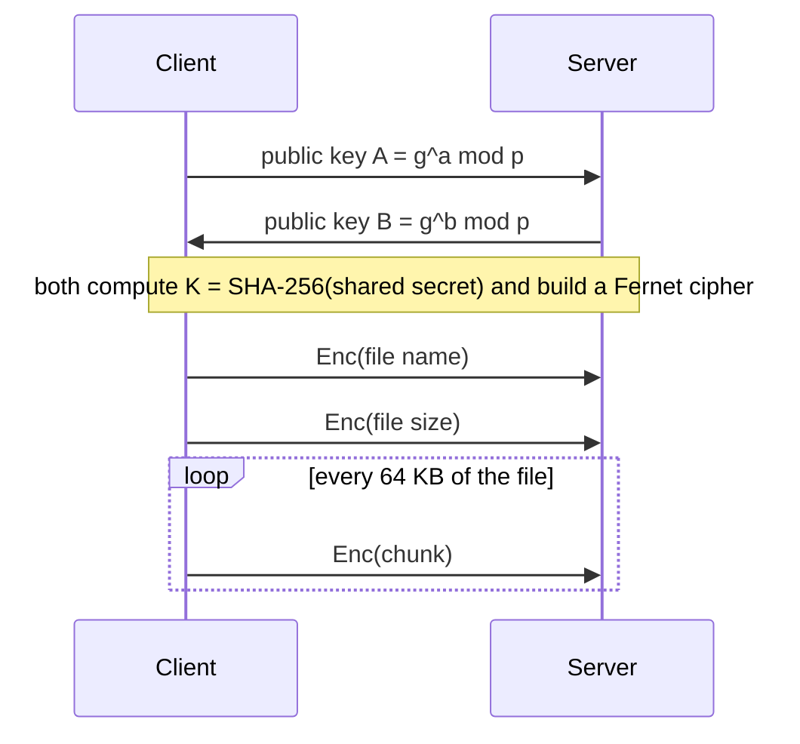

# DH + AES Encrypted File Transfer

[](https://github.com/csanadkneisz/dh-aes-file-transfer/actions/workflows/ci.yml)

A small Python client/server tool that transfers files over TCP. The two sides first agree on a session key with a **Diffie-Hellman key exchange implemented from scratch**, and then send everything (file name, size and content) encrypted with **AES** via `cryptography.fernet`.

The Diffie-Hellman part is a *clean-room* implementation: it uses only the Python standard library (`secrets`, `hashlib` and the built-in modular exponentiation `pow()`). Only the symmetric encryption comes from a third-party library.

## Features

- Diffie-Hellman over the 1536-bit MODP group from [RFC 3526](https://www.rfc-editor.org/rfc/rfc3526) (safe prime, generator 2)
- Private keys drawn from a cryptographically secure source (`secrets`), peer public keys range-checked
- Authenticated encryption of file name, size and content (Fernet: AES-128-CBC + HMAC-SHA256)
- Streaming transfer in 64 KB chunks, so memory use does not depend on the file size
- Length-prefixed framing on top of TCP (4-byte big-endian length), because TCP has no message boundaries
- Command line interface with `server` and `client` subcommands, progress output and clear error messages
- The server only writes inside the chosen directory (path components of the received file name are stripped)

## Requirements

- Python 3.11 or newer (the CI runs 3.11 to 3.13)
- [`cryptography`](https://pypi.org/project/cryptography/) (see `requirements.txt`)

## Installation

```bash
git clone https://github.com/csanadkneisz/dh-aes-file-transfer.git
cd dh-aes-file-transfer
python3 -m venv .venv
source .venv/bin/activate
pip install -r requirements.txt
```

## Usage

Start the receiver in one terminal:

```bash
python dh_key_exchange.py server --dir ./downloads --show
```

Send a file from another terminal:

```bash
printf 'Hello Bob! This is a secret test message.' > message.txt
python dh_key_exchange.py client --file message.txt
```

The server saves the file as `./downloads/received_message.txt`. With `--show`, short UTF-8 text files (up to 4 KB) are also printed to the terminal; larger or binary files are only saved.

### Options

| Command | Option | Default | Description |
|---------|--------|---------|-------------|
| `server` | `--host` | `127.0.0.1` | Address to bind to |
| `server` | `--port` | `5000` | Port to listen on |
| `server` | `--dir` | `.` | Directory for received files (created if missing) |
| `server` | `--show` | off | Print short text files after saving |
| `client` | `--host` | `127.0.0.1` | Server address |
| `client` | `--port` | `5000` | Server port |
| `client` | `--file` | required | File to send |

The server accepts a single client connection and then exits.

## How it works



1. **Key exchange.** Each side picks a random private exponent in `[2, p-2]`, sends `g^x mod p` and computes the shared secret `(peer public key)^x mod p`. Public keys outside `[2, p-2]` are rejected, which blocks trivial values such as 1.
2. **Key derivation.** The decimal representation of the shared secret is hashed with SHA-256; the 32-byte digest is the Fernet key (the first 16 bytes are used for HMAC-SHA256, the last 16 for AES-128-CBC).
3. **Transfer.** File name, size and every 64 KB chunk are encrypted separately and sent as length-prefixed frames. A full chunk becomes a token of about 87 KB (roughly 33% overhead from Fernet's base64 encoding, IV, timestamp and HMAC).

## Tests

```bash
pip install -r requirements-dev.txt
pytest
```

The suite contains unit tests for the cryptographic core (matching keys on both sides, rejection of invalid public keys, tampered ciphertext) and end-to-end tests that start real server and client processes on the loopback interface: a short text message, a 25 MiB random binary compared by SHA-256, a custom port and a missing target directory, a missing input file, an absent server, a port that is already in use, and a hostile file name.

## Limitations

This is a learning project and not a replacement for TLS or SSH.

- **No authentication.** Diffie-Hellman protects against a passive eavesdropper only. An active man-in-the-middle can run a separate key exchange with each side. Fixing this requires authenticated public keys (for example signatures or certificates, as in TLS).
- **Plain SHA-256 as key derivation.** This is acceptable for deriving a single key for a single purpose, but a proper KDF such as HKDF (RFC 5869) would add salt and context binding.
- **No chunk sequence numbers.** Every chunk is an independent Fernet token, so an active attacker could reorder, replay or drop whole chunks without the receiver noticing. Fernet's timestamp is not checked either.
- **No completeness check or acknowledgement.** If the connection is closed between two frames, the server can report success for a truncated file, and the client's success message only means that everything was sent.
- **Partial error handling.** A connection that breaks in the middle of a frame ends the server with a Python traceback.
- **Metadata leakage.** Frame lengths reveal the approximate file size.
- **Tested on loopback only**, on macOS and in CI on Linux.

## Project structure

```
dh_key_exchange.py    Key exchange, encryption, framing, server and client
tests/                Unit and end-to-end tests (pytest)
requirements.txt      Runtime dependency
requirements-dev.txt  Test dependencies
.github/workflows/    Continuous integration
```

## License

MIT, see [LICENSE](LICENSE).
